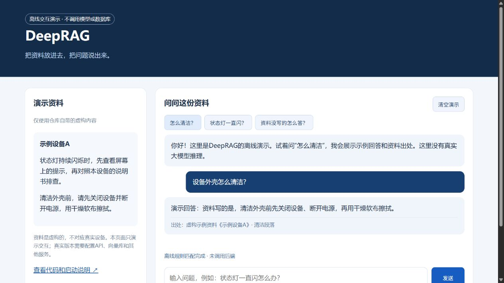
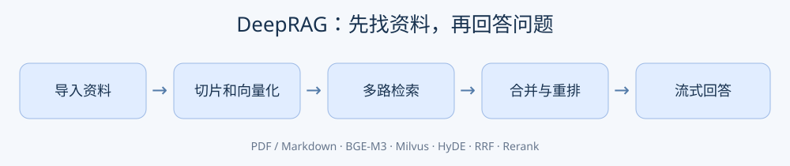

# DeepRAG

把散落的PDF、Markdown资料整理成一个可以直接提问的知识库。

比如，你不用翻完整本说明书，可以直接问“这台设备怎么清洁？”，系统先找资料，再组织答案。项目原来叫“掌柜智库”，所以部分代码和页面仍沿用这个名字。

## 项目演示

[查看演示操作说明](docs/项目演示.md)。不想先装数据库，可以运行离线版：

```bash
python -m http.server 8080 --directory demo
```

浏览器打开 **http://localhost:8080** 。可以点示例问题、输入问题、查看资料出处。**这是有明确标记的离线交互演示，不是真实大模型问答，也不是线上部署地址。**





## 能做什么

- 导入PDF或Markdown；PDF解析接入MinerU。
- 把资料切成小段，处理图片说明，识别涉及的产品名称。
- 用BGE-M3生成稠密和稀疏向量，存入Milvus。
- 提问时走普通检索、HyDE检索和可配置的MCP联网检索。
- 合并检索结果，再用重排模型选出更相关的资料。
- 流式返回答案，并通过MongoDB保存会话记录。

这里的“HyDE”可以理解为：先生成一段可能的答案，再拿它辅助找资料；它不是已经证实的答案。检索和生成也可能出错，重要信息要回到原文核对。

## 真正运行需要什么

Python **3.11或以上**；Milvus、MongoDB、MinIO；BGE-M3模型；支持OpenAI兼容接口的文本/视觉模型；DashScope重排服务；需要解析PDF时配置MinerU；需要联网检索时配置MCP地址和密钥。

这些服务不会因为复制仓库就自动启动，也没有把数据库或大模型权重打包进来。

### 1. 安装依赖

```bash
python -m venv .venv
```

Windows激活：`.venv\Scripts\activate`；macOS/Linux激活：`source .venv/bin/activate`。

```bash
python -m pip install --upgrade pip
python -m pip install torch==2.6.0 --index-url https://download.pytorch.org/whl/cpu
python -m pip install -r requirements.txt
```

上述PyTorch命令是CPU版；GPU使用者应按自己的CUDA环境安装对应版本。requirements记录本机安装版本，不代表所有平台均已重新验证。

### 2. 填配置

把 `.env.example` 复制为 `.env`，在项目根目录运行程序。填入自己的API密钥、数据库连接、MinIO账号、模型位置和MCP地址。不要把 `.env` 上传到GitHub。

- `BGE_M3_PATH`：本地模型目录；不存在时会尝试按 `BGE_M3` 名称下载。
- `BGE_DEVICE=cpu` 可在CPU上跑；模型首次下载可能比较慢。
- `MINIO_ENDPOINT` 只填主机和端口，是否HTTPS由 `MINIO_SECURE` 控制。
- 数据库和外部API的访问权限、费用、额度由你使用的服务决定。

### 3. 启动两个服务

在两个终端中，分别从项目根目录运行：

```bash
python -m uvicorn web.api.import_service:app --host 127.0.0.1 --port 8000
```

```bash
python -m uvicorn web.api.query_service:app --host 127.0.0.1 --port 8001
```

导入页：**http://localhost:8000/import**；问答页：**http://localhost:8001/chat.html**。

前端默认连接本机8000/8001端口，换端口或部署到服务器时，要同步修改页面里的 `API_BASE`。当前版本没有完善的登录和权限管理，先在本机使用，不要直接开放到公网。

## 代码怎么找

| 文件夹 | 大白话说明 |
| --- | --- |
| `processor/import_processor` | 读文档、切片、提取产品名、生成向量、入库 |
| `processor/query_processor` | 理解问题、多路查资料、合并排序、生成答案 |
| `utils` | 数据库、模型、文件存储和消息推送的小工具 |
| `config` | 从环境变量读取设置 |
| `web/api` | 导入和问答两个后端 |
| `web/page` | 导入和聊天页面 |
| `integration_examples` | 需要自己配好真实服务后手动运行的集成示例，会调用外部API |
| `demo` | 无密钥、无数据库的离线界面演示 |

## 本次整理说明

只发布程序、配置模板和新写的项目说明/演示。设备手册、笔记、官方笔记、体育资料、虚拟环境、缓存、模型、数据库镜像和上传文件均未纳入。

发布副本修正了前端路径和 `httpx2` 导入问题；本机原项目没有改动。离线演示不连接真实资料。真实业务依赖外部服务，本次不声称已经完成全流程联网测试。当前代码没有附加开源许可证，使用或再分发前请联系仓库所有者确认授权。
